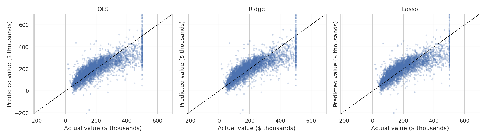

# Datheon Task 2 — California Housing Regression

Compare OLS, Ridge, and Lasso for predicting an area's median house value.
The supplied dataset contains 20,640 California census block groups, nine
predictor columns, and the target `median_house_value`. The data are based
on the 1990 census; this is a benchmark, not a current house-price service.

## Results

| Model | RMSE ($) | MAE ($) | R² |
| --- | ---: | ---: | ---: |
| OLS | 68,917.32 | 49,709.54 | 0.6375 |
| Ridge | 68,968.49 | 49,727.68 | 0.6370 |
| Lasso | 69,003.13 | 49,691.69 | 0.6366 |

Ridge (alpha 10) was selected by five-fold training
cross-validation. Its mean validation RMSE was
$67,766.95. OLS had a slightly lower test RMSE;
Lasso had a slightly lower test MAE. The models are close, and no reliable
superiority is established. Selection was not changed after test evaluation.

The training-mean baseline's test RMSE was $114,485.64; the selected
Ridge model reduced it by 39.76% on this split.



## Approach

1. Check the supplied CSV for missing values, repeated rows, category labels,
   measurement ranges, and invalid ratio denominators. Retain all rows.
2. Reserve 20% of rows as a fixed test set (`random_state=42`): 16,512 training
   rows and 4,128 test rows. Exploration uses training rows.
3. Create rooms per household, bedrooms per room, population per household,
   and an income-by-rooms interaction. These are deterministic row-level rules.
4. Use a pipeline that fits median imputation and numeric standardisation
   within each training fold. One-hot encode ocean proximity and drop one
   reference category to avoid redundant dummy columns.
5. Fit OLS and use GridSearchCV to tune Ridge and Lasso over fixed alpha grids.
   Select by mean validation RMSE before computing the test metrics.
6. Compare RMSE, MAE, R², coefficients, predictions, and residual diagnostics.

Ridge alphas: 0.01, 0.1, 1, 10, 100, 1000.
Lasso alphas: 1, 10, 100, 1000, 10000.
Five shuffled folds use `random_state=42`. Lasso uses up to 20,000 iterations
and tolerance 0.0001. Missing bedrooms and the derived missing bedroom ratios
are imputed separately using each fold's training medians. Categorical
indicators remain 0/1; continuous predictors are standardised.

## Data decisions and limitations

- The raw CSV is unchanged. There are 207 missing bedroom values, no repeated
  complete rows, and five ocean categories. No outliers or capped rows were removed.
- The target contains 965 observations recorded at $500,001 (4.68% of rows).
  This limit obscures the underlying values of expensive areas.
- Area-size predictors are strongly correlated. Regularisation shrinks their
  coefficients; it does not prove that every stability issue is eliminated.
- The ISLAND category contains only five rows in the full file. Lasso's zero
  ISLAND coefficient does not establish absence of an association.
- Negative test predictions occur in OLS (10),
  Ridge (10), and Lasso (9).
  Predictions are left unclipped in the reported scores. These linear models
  are unsuitable as direct property appraisals.
- Random splitting can place nearby areas in both samples. Spatially separated
  validation and newer data would be needed for deployment claims.
- R² is explained variation relative to a test-mean reference, not prediction
  accuracy. Coefficients and observed patterns do not establish causal effects.

## Files

- `Datheon_Task2_Housing_Regression.ipynb`: executed analysis with all required plots and comparisons.
- `housing.csv`: supplied raw data.
- `figures/`: six plots used in the analysis.
- `results/`: model metrics, validation scores, alpha search, coefficients,
  test predictions, and residuals.
- `requirements.txt`: tested analysis dependencies.
- `ATTRIBUTION.md`: dataset background and method references.

## Run

Use Python 3.11 or newer; the analysis was executed with Python 3.12.
Extract the project, open a terminal in this folder, and run:

```bash
python -m pip install -r requirements.txt notebook
python -m notebook
```

Open `Datheon_Task2_Housing_Regression.ipynb`, select the Python environment containing the packages,
and run all cells from top to bottom. Keep `housing.csv` beside the notebook.
The notebook creates its own output folders and uses no private files or
machine-specific paths. In Google Colab, upload both the notebook and the CSV.

## Task coverage

| Requirement | Notebook section |
| --- | --- |
| Data checks and missing-value handling | 2, 6 |
| Correlation heatmap and multicollinearity discussion | 4, 10 |
| Ratios and interaction feature | 5 |
| Numeric standardisation and categorical encoding | 6 |
| OLS, Ridge, Lasso, and alpha tuning | 7 |
| RMSE, MAE, and R² comparison | 8 |
| Predicted versus actual and residual error plots | 9 |
| Implausible predictions and limitations | 11–12 |
